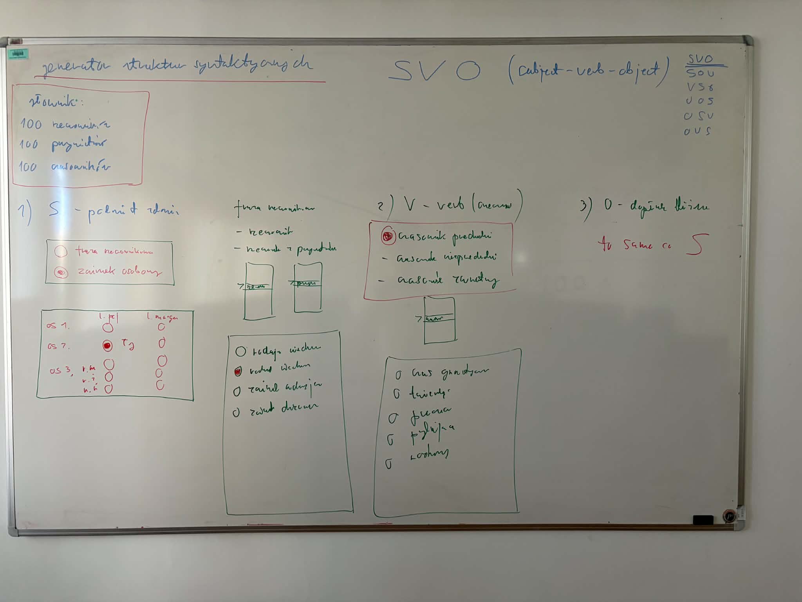

# Przetwarzanie-Jezyka-Naturalnego-SEM5

Alex Cimr, Piotr Cieckiewicz

# Zrobic sprawozdanie ze wszystkich zadan

## Task 1 - DONE
- Zgromadzic teksty w jezyku francuskim (ogolny, utwory literackie) razem ok 100tys wyrazów - tworzymy korpus
- Oczyscic korpus, czyli zostawiamy tylko litery(wyrazy) bez liczb itp.(nadal ma byc 100tys słów)

## Task 2
- Policzyc czestosc wystepowania wszystkich liter
- Wyznaczyc entropie tekstu
- Wyznaczyc kody huffmana
- Wyliczenie efektywnosci kompresji korpusu tesktu

## Task 3
- Sprawdzenie czy zachodzi prawo Zipfa i jak dobrze
- Ile trzeba znac wyrazow zeby rozumiec 90% teskstu, zrobic liste tych wyrazow
- Znalesc rdzenie jezyka tzn mamy graf slow, krawdzie tworzymy tak: Ala ma bialego kota. - dla "ma" tworzymy krawedz do ala i kota.
  Szukamy rdzenii czyli pierwsze 100 wyrazow ktore maja najwiecej krawedzi.

## Task 4 (to juz na 4.5)
- zrobic program w graficzny interface uzytkowanika i pozwoala na tworzenie porposaniw ezrobionych zdan SVO - umozliwia podowe poprawnie syntatycznie zdan - podmiotem moze byc zaimek osobowy to wybiera osobe gramatyczna i liczbe cos takiego
- jak rzeczonwik to z listy roziwjanem wybiera czaswaniko i takie ta -> gruby i wybiera sciana to gruba sciana. jak czasnowink to jaki czasnownik przechdni albo zwortny albo jaki. z listy roziwnajen to wysztsko. rozne parametry czas gramatyczny tzrba ustawic. zdanie tweirdzace przeczace ytanjace trzeba wybrac.
- slwonik 100 rzeczownikow przymitnikow i czasnownik
- moze byc jezyk polski / angielski - moze byc zdanie bez sensu
- do sprawozdania to dopisac i zrobic fajny ui
